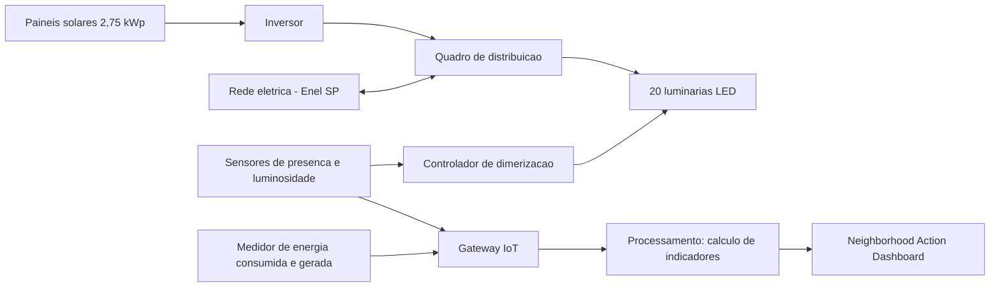

# CitizenTech - Contribuição de SERS (Soluções em Energias Renováveis e Sustentáveis)

**Global Solution 2026.2**

## Integrantes
- Enzo Lozano – RM 574944 
- João Florencio – RM 576950
- Ryan Alves – RM 576880

## Problema
Praça comunitária no bairro Ipiranga (SP) com iluminação convencional ligada
~12 h por noite em potência máxima, sem monitoramento.

## Solução
Comparação entre (A) troca por LED e (B) LED com dimerização por sensor de
presença + energia solar fotovoltaica, com indicadores no Neighborhood Action Dashboard.

## Cálculo base
E (kWh) = P (W) x t (h) / 1000

## Diagrama


## Dados utilizados

Usamos uma **praça-modelo** com **dados estimados**
**Premissas** da planilha [Planilha energia - SERS.xlsx](Planilha%20energia%20-%20SERS.xlsx).

Os resultados são **projeções modelos**, e não valores medidos ou garantidos.

## Como usar

Os cálculos da contribuição de SERS estão na planilha
[Planilha energia - SERS.xlsx](Planilha%20energia%20-%20SERS.xlsx), organizada em três abas:

| Aba | Conteúdo |
|---|---|
| **Premissas** | Dados de entrada (luminárias, potências, tarifa, custos) |
| **Cálculos** | Passo a passo com a fórmula E = P × t / 1000, comparação das alternativas e dimensionamento solar |
| **Indicadores** | Indicadores do dashboard e gráfico comparativo entre os cenários |

O arquivo [`calculo_indicadores.py`](calculo_indicadores.py) mostra os cálculos e precisa de Python 3 instalado para a execução:

```bash
python calculo_indicadores.py
```
## Referências

- BRASIL. Ministério da Ciência, Tecnologia e Inovação (MCTI). SIRENE: fatores de emissão de CO₂ da geração de energia elétrica. https://www.gov.br/mcti/pt-br/acompanhe-o-mcti/sirene/dados-e-ferramentas/fatores-de-emissao. 
- EIXOS. Brasil tem menor taxa de emissão de carbono na geração elétrica em onze anos. https://eixos.com.br/brasil-tem-menor-taxa-de-emissao-de-carbono-na-geracao-eletrica-em-onze-anos/. 
- AGÊNCIA INFRA. ANEEL aprova reajuste de 10,18% nas tarifas da Enel SP. 30 jun. https://agenciainfra.com/blog/?p=43652. 

## Observações

- Os resultados são projeções modelo, e não resultados garantidos.
- Número de luminárias, potências, tarifa, custos e horas de sol pleno são estimativas.
- Na alternativa B, o balanço de 100% de energia renovável depende da compensação de créditos na rede, porque a geração é diurna e a iluminação é noturna. Baterias não foram consideradas.
- Não foram considerados taxas e encargos da compensação, manutenção nem as emissões do ciclo de vida dos painéis.
- Como a matriz elétrica brasileira já é pouco emissora, as emissões evitadas são pequenas em termos absolutos.
- O dashboard usa dados estimados ou simulados, sem medição real.
