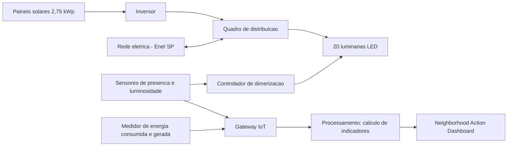

# CitizenTech - Contribuição de SERS (Soluções em Energias Renováveis e Sustentáveis)

**Global Solution 2026.2 | Ciência da Computação**

## Integrantes
- Enzo Lozano – RM 574944 
- João Florencio – RM 576950
- Ryan Alves – RM 576880

## Problema
Praça comunitária no bairro Ipiranga (SP) com iluminação convencional ligada
~12 h por noite em potência máxima, sem monitoramento.

## Solução
Comparação entre (A) troca por LED e (B) LED com dimerização por sensor de
presença + energia solar fotovoltaica, com indicadores no Neighborhood Action Dashboard.

## Cálculo base
E (kWh) = P (W) x t (h) / 1000

## Diagrama

## Indicadores
Consumo (kWh/mês), economia (%), redução de custo (R$/mês),
participação renovável (%), emissões evitadas (kg CO2e/ano).

## Como rodar
python calculo_indicadores.py

## Referências
(liste cada fonte: MCTI/SIRENE, ANEEL, CRESESB, cotações de preços etc.)

**Contribuição de SERS:** pasta /sers
